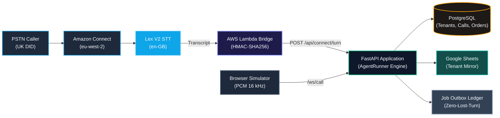

# Architecture

This document describes the **private product’s** shape as audited on 2026-10-23,
and marks which parts are reproduced in the public demo. It contains no hostnames,
credentials, customer identifiers, or production configuration.


---

## 1. System context


<details>
<summary><b>🔍 View Mermaid System Context Specification</b></summary>



</details>

Two ingress paths share one turn engine:

1. **PSTN path.** Connect handles telephony and Lex handles speech capture. The
   Lambda bridge signs each turn. The API never receives audio on this path.
2. **Browser path.** A simulator streams PCM frames to `/ws/call`; STT and TTS run
   server-side. This is a demo/QA path, not the phone path.

---

## 2. Components

| Component | Responsibility | Public treatment |
| --- | --- | --- |
| Amazon Connect contact flow | Answer, prompt, invoke Lambda, play reply | Diagram only; flow JSON excluded |
| Lex V2 bot | `en-GB` speech capture | Diagram only; bot config excluded |
| Lambda bridge | Validate input, sign request, call API, return text | Short sanitized excerpt |
| FastAPI API | Auth, routing, turn orchestration, persistence | Documented, not published |
| `AgentRunner` | Prompt assembly, LLM loop, tool dispatch, reply sanitising | Short sanitized excerpts |
| Tool layer | 22 typed-by-convention tools over Postgres/Sheets | Categories and safety matrix only |
| Postgres | Tenants, users, calls, orders, shipments, audit, jobs | Schema described, not published |
| Google Sheets | Optional per-tenant operational mirror | Described only |
| Durable job ledger | Campaign + side-effect jobs with retries | Described only; workers disabled |
| Next.js dashboard | Tenant workspace, call review, analytics | Screens excluded |
| Stripe billing | Plan catalogue + metered minutes | Excluded from public repo |

The private repo is a monorepo: `apps/api/` (FastAPI), `apps/web/` (Next.js App
Router), `deploy/` (AWS + infrastructure), `migrations/` (Postgres, through `029_`).

---

## 3. Turn engine

```text
transcript + session
        │
        ▼
 tenant + DID resolution (exact match, fail closed)
        │
        ▼
 system prompt (tenant-scoped, cached ~60 s)
        │
        ▼
 LLM loop (max 5 iterations)
        │  tool call
        ▼
 policy checks ──► tool execution ──► result validation
        │                                   │
        └──────────────┬────────────────────┘
                       ▼
          spoken-output sanitisation
          (strip markup, block unbacked status,
           block false write claims, cap sentences)
                       │
                       ▼
                 reply text
```

Important properties:

- **Tenant resolution happens before prompt or tool work.** An unmapped or inactive
  DID returns a not-found response; there is no default tenant.
- **The LLM does not speak directly to the caller.** Its text passes through
  sanitisation and, for status facts, a grounding check.
- **Tool results are data, not instructions.** The product has no dedicated
  instruction/data classifier; this remains a gap (see
  [THREAT-MODEL.md](THREAT-MODEL.md)).
- **The turn deadline is 6 seconds** with a 5-iteration cap. A timeout escalates.

---

## 4. Identity and authorisation

| Factor | Mechanism | Bound to |
| --- | --- | --- |
| Knowledge | Company/account reference + city, VAT, or contact name | Supplier record |
| Possession | 4–8 digit caller PIN, PBKDF2-HMAC-SHA256, 310,000 iterations | Same supplier record |
| Session | Verified flags + supplier binding stored on the call session | Current call only |

PIN handling:

- Random 16-byte salt per PIN.
- Constant-time comparison.
- Malformed or out-of-range hashes fail closed.
- Attempt limits and persistent lockout.
- Standalone 4–8 digit sequences are redacted from persisted tool JSON and logs.
- Writes that require a PIN check that the **PIN-verified supplier** equals the
  **knowledge-verified supplier**; a PIN for another account cannot authorise the
  write.

The public excerpt is in
[code-walkthrough/01-pin-binding.md](code-walkthrough/01-pin-binding.md).

**Gap:** authorisation is not the same as confirmation. The private product does
not yet require a second caller “yes” bound to the exact write arguments.

---

## 5. Tool layer

The private product exposes 22 tools. Categories:

- **Read:** order status, order details, shipment status, stock, supplier lookup,
  sheet read, call context.
- **Write:** create PO, schedule appointment, update order status, log outcome,
  edit sheet row, create escalation.
- **External:** SMS, email/notification, webhook-style side effects.
- **Prohibited/absent:** refunds and money movement are not implemented.

Every tool receives the call session and must scope SQL by `tenant_id`. Some tools
also require identity or PIN. Results are plain dictionaries; there is **no shared
schema validator** for arguments or results. That is a P0 gap.

The public demo models a smaller, stricter tool surface so every gate is visible and
testable. Its tool set is not the private schema.

---

## 6. Persistence

| Store | Contents | Notes |
| --- | --- | --- |
| Postgres | Tenants, memberships, phone numbers, suppliers, orders, shipments, calls, turns, tool audit, escalations, jobs | Primary source of truth |
| Google Sheets | Tenant-specific operational mirror | Optional, allow-listed |
| S3 | Call recordings | Only if recording enabled; retention deployment-dependent |
| Provider logs | Errors and telemetry | Redaction is not complete |

Tenant isolation relies on **explicit `tenant_id` predicates** in queries. Row-level
security policies exist but are inert in the audited deployment (the application
connects with a role that bypasses them). The code therefore treats RLS as
defence-in-depth that is currently **not active**, not as the primary control.

---

## 7. Jobs and side effects

A durable job ledger records campaign and side-effect work with idempotency keys,
attempt counts and dead-letter state. The two worker loops are **disabled by
default** and must be enabled per tenant. No outbound dialling adapter is live.

This is intentionally conservative: a job that is recorded but not executed is
safer than an unverified side effect. The trade-off is that “queued” does not mean
“sent”; the UI and copy must say so.

---

## 8. Deployment shape

- API: containerised FastAPI process with Postgres and Redis (replay ledger,
  rate limits).
- Web: Next.js App Router, separately hosted.
- Telephony: Amazon Connect + Lex V2 in **eu-west-2 (London)**.
- Secrets: environment variables / managed secret store; never in git.
- CI: lint, backend tests, frontend lint/build, security scan.

Deployment files, Terraform state, account identifiers and hostnames are excluded
from this repository.

---

## 9. What the public demo reproduces

| Concern | Private product | Public demo |
| --- | --- | --- |
| Telephony | Connect + Lex + Lambda | None; text turns only |
| STT/TTS | Groq Whisper / Polly / Edge TTS | None |
| LLM | Groq `gpt-oss-20b` + fallbacks | None; deterministic regex intent parser |
| State machine | Implemented | Implemented |
| Identity + PIN | Implemented | Implemented (synthetic values) |
| Confirmation gate | **Missing** | Implemented |
| Argument/result schema | **Missing** | Implemented |
| Idempotency | Partial / tool-specific | Implemented for writes |
| Grounding guard | Implemented (lexical) | Implemented (allow-list) |
| Tenant isolation | Explicit query filters | Single-process fixture scoping |
| Durable jobs | Implemented, disabled | Not modelled |

The demo is a **reference model of the target contract**, built to make safety
properties executable and reviewable. It is not a runtime dependency of the private
product and shares no production code.

---

## 10. Design constraints

- **UK English and UK telephony.** `en-GB`, `Europe/London`, `eu-west-2`.
- **Fail closed.** Missing DID, tenant, secret, consent, or tool result = refuse or
  escalate.
- **No inline provider calls from HTTP handlers.** Work goes through services/jobs.
- **No global workers.** Side effects require an explicit tenant allow-list.
- **Single pricing source.** The private billing catalogue is the only source of
  plan limits; public marketing must not hardcode numbers.

These constraints are product rules, not claims that every rule is fully enforced.
See [LIMITATIONS.md](LIMITATIONS.md).
