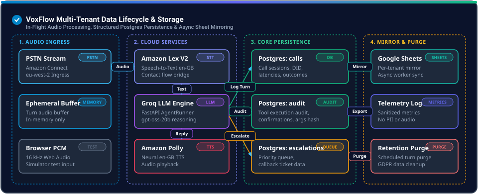

# Privacy and data lifecycle

> **This is not a compliance statement.** VoxFlow is not certified under GDPR,
> SOC 2, ISO 27001 or PCI DSS, and this document does not assert a lawful basis for
> any processing. It describes what the audited code does and where it falls short.

The public repository contains **no real personal data**. Accounts, names,
postcodes, PINs, order references and phone digits in the demo are invented.

---

## 1. Data flow



```text
Caller speech
  → Amazon Connect / Lex (transcript)
  → Lambda bridge
  → API session
      ├─ transcript turns → Postgres
      ├─ tool arguments/results → Postgres (PIN redacted)
      ├─ call outcome → Postgres + optional Google Sheet
      ├─ errors/telemetry → logs / error tracker
      └─ prompt/trace data → LLM/STT providers (deployment-dependent)

Recordings (if enabled)
  → Connect → S3, pointer stored on the call row
```

---

## 2. Data categories

| Category | Examples | Where it lives | Default retention in code |
| --- | --- | --- | --- |
| Call metadata | contact ID, DID, direction, timestamps, outcome | Postgres | 90 days, then anonymised |
| Transcript | caller and agent turns | Postgres; error traces; Sheets | 30 days, then blanked |
| Summary fields | reason, solution, staff resolution | Postgres | 30–90 days |
| Caller identity | name, company, phone, VAT | Postgres; Sheets | tenant-configured |
| PIN verifier | PBKDF2 hash + salt | Postgres | account lifetime |
| Tool arguments/results | order IDs, status, slots, messages | Postgres; Sheets | mixed; no single job |
| Communications | recipient, body, subject, status | Postgres | 90 days (masked, not deleted) |
| Recordings | audio objects | S3 | 30 days (tag/lifecycle) |
| Logs/telemetry | errors, request IDs, stack traces | local/container/provider | deployment-dependent |
| Session snapshots | recovery state on disk | host filesystem | deleted on clean end |
| Analytics | counts, latencies, outcomes | Postgres/provider | deployment-dependent |

The code defaults above are not a promise. A deployment can change them, and
several data paths (provider logs, Sheets, backups) are outside the retention job.

---

## 3. What works

- **PIN redaction.** Standalone 4–8 digit sequences are redacted from persisted tool
  JSON and logs; PIN hashes are PBKDF2 with a unique salt.
- **Tenant-scoped queries.** Call, order, supplier and communication reads filter
  `tenant_id`.
- **Retention job.** A scheduled purge blanks transcripts and summaries and
  anonymises call rows after the configured window. It writes a per-tenant purge
  log.
- **Recording deletion helper.** Erasure can delete an S3 object by key.
- **DSAR export.** A tenant-scoped export exists for call-related data.
- **Consent flag.** Recording/assistance consent is stored per call where enabled.

---

## 4. What is partial or missing

| Gap | Consequence |
| --- | --- |
| Erasure anonymises but does not delete all rows | Tool audit, communications, jobs and sheet rows can survive |
| No single data map enforced in code | New tables can escape retention |
| Google Sheets mirror has no deletion path | Tenant spreadsheet retains call data indefinitely |
| Provider logs/traces have unknown retention | Transcript/PII may persist outside the app |
| Recordings depend on S3 lifecycle configuration | Code alone does not prove deletion |
| Backups are not covered by erasure | Deleted data can reappear on restore |
| Logs can contain free text | Caller speech or tool output may include PII/secrets |
| Consent evidence is thin | No immutable record of what the caller heard |
| No deletion receipt | Cannot prove erasure to a data subject |
| No documented legal basis/DPIA | Processing may be unlawful even if code works |

The private audit lists 26 privacy gaps. The six that matter most are: partial
erasure, sheet mirror retention, provider logging, backups, free-text logs, and the
absence of a deletion receipt.

---

## 5. Subprocessors and egress

The private system can send data to:

- **Telephony:** Amazon Connect / Lex / S3 (UK region).
- **Speech-to-text:** Groq Whisper (audio or transcript, depending on path).
- **LLM:** Groq-hosted model, with fallbacks.
- **TTS:** Amazon Polly (PSTN) or Edge TTS (browser simulator).
- **Operational mirror:** Google Sheets, per tenant.
- **Billing:** Stripe (plan and usage metadata).
- **Error tracking / tracing:** deployment-dependent.

Contracts, data-processing agreements, retention settings and regions for these
providers are **deployment tasks**, not properties of this repository. The audit
did not verify them.

---

## 6. Erasure path

```text
erase(tenant, subject)
  ├─ find calls / communications
  ├─ blank transcript, summary fields
  ├─ mask communication recipient/body
  ├─ delete recording object (if S3 key present)
  └─ write purge log

Not covered:
  ├─ Google Sheet rows
  ├─ provider logs / traces
  ├─ backups
  ├─ tool audit rows and job payloads
  └─ derived analytics
```

This is a **partial erasure**, not a complete one. Any privacy copy must say so.

---

## 7. Logging rules

- Never log a PIN, secret, Authorization header, or full request body.
- Redact standalone 4–8 digit sequences before persisting tool JSON.
- Treat transcripts and sheet cell text as personal data.
- Do not paste production transcripts into issues, prompts, or the public repo.
- Error trackers must scrub cookies and authorization headers; this does not make
  free-text payloads safe.

The public repo follows the same rules: no real transcripts, no recordings, no
customer identifiers, no provider payloads.

---

## 8. Public demo data

| Item | Nature |
| --- | --- |
| `acct_synthetic_001/002` | Invented account IDs |
| `Demo Depot Alpha`, `Fixture Freight Beta` | Invented companies |
| `M1 4AB`, `B1 1AA` | Real-format UK postcodes used as synthetic values |
| `0142`, `0199` | Invented last-4 digits |
| `4821`, `7310` | Invented demo PINs |
| `PO-SYN-*` | Invented order references |
| `2026-10-*` | Invented dates |

No fixture maps to a real person, company, phone number or order.

---

## 9. Founder tasks before any pilot

These are not code tasks and are not satisfied by this repository:

1. Write the data map and retention schedule, including Sheets, logs and backups.
2. Obtain provider DPAs and confirm regions/retention.
3. Implement an end-to-end erasure path with a receipt.
4. Add a deletion path for the Sheets mirror.
5. Decide the lawful basis and complete a DPIA.
6. Publish a privacy notice that matches the code.
7. Test a DSAR end to end, including provider data.
8. Define consent evidence for recording.

Until then, the honest description is: **privacy controls are partial and
deployment-dependent.**
